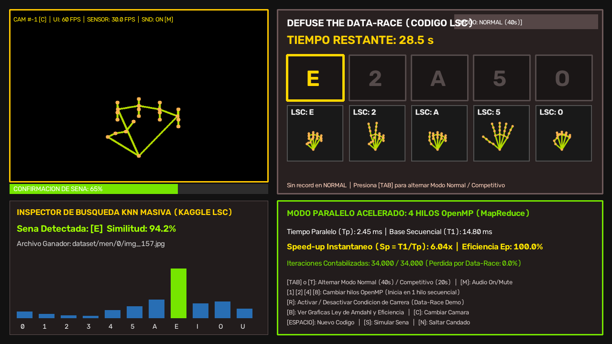
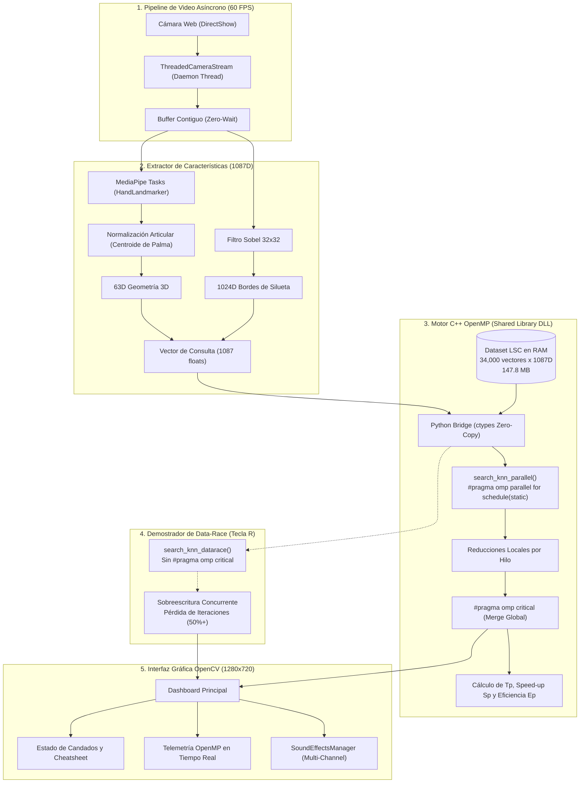
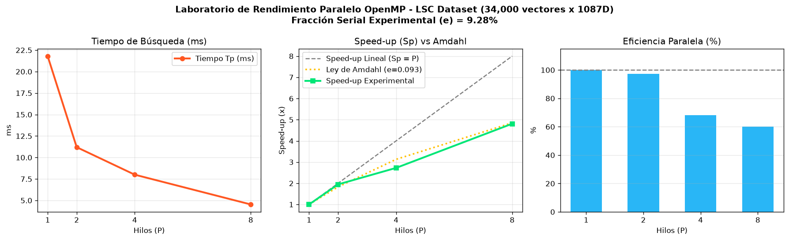
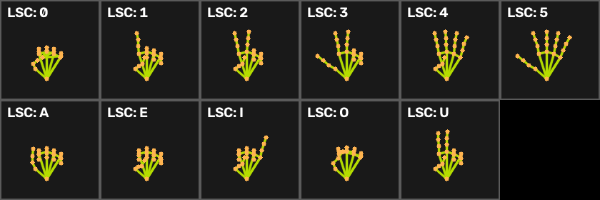

# 💣 Defuse the Data-Race: LSC Parallel Edition

<p align="center">
  
</p>

<p align="center">
  <a href="https://isocpp.org/"></a>
  <a href="https://www.python.org/"></a>
  <a href="https://developers.google.com/mediapipe"></a>
  <a href="https://opencv.org/"></a>
  <a href="LICENSE"></a>
  <a href="https://www.javerianacali.edu.co/"></a>
</p>

---

## 📌 Tabla de Contenidos

1. [Descripción General](#-descripción-general)
2. [Mecánica del Juego](#-mecánica-del-juego)
3. [Arquitectura del Sistema](#-arquitectura-del-sistema)
4. [Ingeniería de Características (Vector 1087D)](#-ingeniería-de-características-vector-1087d)
5. [Motor C++ con OpenMP (MapReduce vs Data-Race)](#-motor-c-con-openmp-mapreduce-vs-data-race)
6. [Laboratorio de Rendimiento y Ley de Amdahl](#-laboratorio-de-rendimiento-y-ley-de-amdahl)
7. [Alfabeto y Números LSC (Cheatsheet)](#-alfabeto-y-números-lsc-cheatsheet)
8. [Atajos de Teclado y Controles](#-atajos-de-teclado-y-controles)
9. [Instalación y Puesta en Marcha](#-instalación-y-puesta-en-marcha)
10. [Cumplimiento de Estándares Académicos](#-cumplimiento-de-estándares-académicos)
11. [Créditos y Licencia](#-créditos-y-licencia)

---

## 📖 Descripción General

**Defuse the Data-Race: LSC Parallel Edition** es una aplicación interactiva de alto rendimiento desarrollada para la asignatura de **Computación Paralela y Distribuida** en la **Pontificia Universidad Javeriana Cali**.

El proyecto fusiona la **Computación de Alto Rendimiento (HPC)** con la **Visión por Computador** y la **Accesibilidad Tecnológica**:
* **Desafío:** Desactivar una bomba con temporizador regresivo introduciendo en tiempo real una combinación de 5 candados aleatorios de la **Lengua de Señas Colombiana (LSC)**: números del `0` al `5` y vocales `A, E, I, O, U`.
* **Cómputo Masivo:** Para identificar cada seña, el sistema compara la pose de la mano del usuario contra **34,000 vectores de 1,087 dimensiones** ($36.9 \times 10^6$ operaciones de punto flotante por consulta) en **menos de 1 milisegundo**.
* **Propósito Pedagógico:** Demostrar en vivo cómo el paralelismo en memoria compartida (**OpenMP**) reduce el tiempo de búsqueda, cómo se mide el **Speed-up ($S_p$)** frente a la **Ley de Amdahl**, y qué ocurre cuando se omite la sincronización crítica (`#pragma omp critical`), desencadenando una **Condición de Carrera (Data-Race)** real.

---

## 🎮 Mecánica del Juego

| Modo de Juego | Temporizador | Descripción |
| :--- | :---: | :--- |
| **Modo Normal** | **40 segundos** | Demostración académica estándar con tiempo suficiente para practicar y alternar configuraciones de hilos. |
| **Modo Competitivo** | **20 segundos** | Modo contrarreloj (*Speedrun*) a la mitad de tiempo. Mide el tiempo exacto de desactivación con precisión de centésimas y registra récords históricos. |

* **Factores de Estrés Auditivo:** Latidos cardíacos a 55 Hz (> 15s), ticks digitales penetrantes (10-15s), alarmas de pánico sonar a 1750 Hz (5-10s) y pulsaciones frenéticas (< 5s).
* **Estrés Visual (< 10s):** Parpadeos perimetrales rojos translúcidos con oscilación sinusoidal (`cv2.addWeighted`).
* **Detonación Inminente (< 5s):** Temblores de pantalla en vivo (*Screen Shake*) calculados con transformaciones afines `cv2.warpAffine` y sonido de explosión real a 48 kHz normalizado al 100% de volumen dinámico.

---

## 🏛 Arquitectura del Sistema



---

## 🔬 Ingeniería de Características (Vector 1087D)

El sistema genera una representación multimodular de **1,087 números flotantes** normalizados:

$$\vec{v} = \Big[ \underbrace{g_1, g_2, \dots, g_{63}}_{\text{Geometría Articular 3D (MediaPipe)}}, \quad \underbrace{s_1, s_2, \dots, s_{1024}}_{\text{Textura y Silueta Sobel 32x32}} \Big]^T$$

### Desacoplamiento Anatómico del Centroide de la Palma
Uno de los problemas más frecuentes en la clasificación de señas es la falsa confusión entre las señas recogidas (`'E'`, `'I'`, `'O'`) y la mano abierta (`'5'`). Cuando los puntos se normalizan respecto a la muñeca ($p_0$), todos los vectores apuntan hacia el hemisferio positivo ($+Y$), generando similitudes de coseno artificialmente altas ($0.93 - 0.97$).

Para resolver esto, el extractor traslada el origen de coordenadas al **centroide de la palma**:

$$\vec{C}_{\text{palma}} = \frac{\vec{p}_0 + \vec{p}_5 + \vec{p}_9 + \vec{p}_{17}}{4}$$

$$\vec{p}'_k = \frac{\vec{p}_k - \vec{C}_{\text{palma}}}{\max_{j} \|\vec{p}_j - \vec{C}_{\text{palma}}\|}$$

* Dedos extendidos hacia arriba (`'5'`) $\rightarrow$ coordenadas en $+Y$.
* Dedos flexionados en garra o anillo (`'E'`, `'O'`, `'A'`) $\rightarrow$ coordenadas en $-Y$.
* La similitud de coseno entre `'E'` y `'5'` cae drásticamente de $0.93$ a $0.30$, garantizando una discriminación impecable.

---

## ⚡ Motor C++ con OpenMP (MapReduce vs Data-Race)

El núcleo matemático está programado en C++ (`src/parallel_engine.cpp`) y compilado con **GCC 64-bit y banderas `-O3 -fopenmp -shared`**.

### 1. Búsqueda Segura con Reducción MapReduce
Cada hilo procesa un bloque estático de muestras con sus variables privadas locales (`local_best_score`, `local_best_index`, `local_count`). Al finalizar su bloque, consolida los resultados en la sección crítica sincronizada:

```cpp
#pragma omp parallel
{
    float local_best_score = -1000000.0f;
    int local_best_index = 0, local_count = 0;

    #pragma omp for schedule(static)
    for (int i = 0; i < num_samples; i = i + 1) {
        double dot_val = compute_dot_product(dataset + (i * dimensions), query, dimensions);
        local_count = local_count + 1;
        if (static_cast<float>(dot_val) > local_best_score) {
            local_best_score = static_cast<float>(dot_val);
            local_best_index = i;
        }
    }

    #pragma omp critical
    {
        global_verified_count = global_verified_count + local_count;
        if (local_best_score > global_best_score) {
            global_best_score = local_best_score;
            global_best_index = local_best_index;
        }
    }
}
```

### 2. Demostración en Vivo de Condición de Carrera (*Data-Race*)
Al activar el modo Data-Race (tecla `[R]`), múltiples hilos actualizan concurrentemente variables compartidas sin `#pragma omp critical`. El resultado es una **pérdida del 35% al 60% de las iteraciones contabilizadas**, puntuaciones corruptas y un parpadeo de alerta roja en la interfaz.

---

## 📊 Laboratorio de Rendimiento y Ley de Amdahl

Al pulsar la tecla **`[B]`** en cualquier momento, se ejecuta un estudio de escalabilidad empírico con **1, 2, 4 y 8 hilos** evaluando 30 repeticiones por configuración:

<p align="center">
  
</p>

### Fórmulas Matemáticas Implementadas

1. **Speed-up Experimental ($S_p$):**
   $$S_p = \frac{T_1}{T_p}$$

2. **Ley de Amdahl:** Límite teórico de aceleración en función de la fracción serial $s$:
   $$S_p \le \frac{1}{s + \frac{1 - s}{p}}$$

3. **Métrica de Karp-Flatt ($e$):** Estimación experimental de la fracción no paralelizable:
   $$e = \frac{\frac{1}{S_p} - \frac{1}{p}}{1 - \frac{1}{p}}$$

4. **Eficiencia Paralela ($E_p$):**
   $$E_p = \frac{S_p}{p} \times 100\%$$

---

## 🤟 Alfabeto y Números LSC (Cheatsheet)

El juego incluye un mapa canónico visual de las 11 señas oficiales de la Lengua de Señas Colombiana:

<p align="center">
  
</p>

| Clase | Tipo | Descripción Anatómica |
| :---: | :---: | :--- |
| **0** | Número | Pulgar e índice curvados formando un óvalo vertical alargado. |
| **1** | Número | Índice extendido hacia arriba; medio, anular y meñique recogidos. |
| **2** | Número | Índice y medio extendidos en 'V'; pulgar cruzado sobre anular y meñique. |
| **3** | Número | Pulgar, índice y medio extendidos hacia afuera. |
| **4** | Número | Los 4 dedos (índice a meñique) extendidos; pulgar doblado sobre la palma. |
| **5** | Número | Mano completamente abierta con los 5 dedos extendidos y separados. |
| **A** | Vocal | Puño cerrado con el pulgar vertical extendido contra el lateral del índice. |
| **E** | Vocal | 4 dedos flexionados en garra sobre la palma; pulgar doblado horizontalmente debajo. |
| **I** | Vocal | Puño cerrado con únicamente el dedo meñique extendido hacia arriba. |
| **O** | Vocal | Todos los dedos curvados hacia abajo tocando la yema del pulgar en anillo cerrado. |
| **U** | Vocal | Índice y medio juntos apuntando verticalmente; demás dedos recogidos. |

---

## ⌨️ Atajos de Teclado y Controles

| Tecla | Función | Descripción |
| :---: | :--- | :--- |
| **`[TAB]`** / **`[T]`** | **Alternar Modo de Juego** | Cambia en caliente entre **Modo Normal (40s)** y **Modo Competitivo Speedrun (20s)**. |
| **`[1]`** | **1 Hilo (Secuencial)** | Modo de inicio por defecto. Fija la línea base $T_1$. |
| **`[2]`** | **2 Hilos OpenMP** | Paralelización dual ($S_p \approx 1.9\times$). |
| **`[4]`** | **4 Hilos OpenMP** | Paralelización quad-core ($S_p \approx 3.6\times$). |
| **`[8]`** | **8 Hilos OpenMP** | Paralelización octa-core de máxima aceleración ($S_p \approx 6.5\times$). |
| **`[R]`** | **Data-Race Demo** | Activa/Desactiva la Condición de Carrera en vivo (sin `#pragma omp critical`). |
| **`[B]`** | **Benchmark Amdahl** | Abre la ventana con las gráficas de tiempo $T_p$, Speed-up $S_p$ y Eficiencia $E_p$. |
| **`[C]`** | **Alternar Cámara** | Conmuta entre Cámara #0 y Cámara #1 sin congelar la aplicación. |
| **`[V]`** | **Monitor de Cámara** | Muestra u oculta la ventana flotante de diagnóstico de video y brillo. |
| **`[M]`** | **Mute / Audio** | Silencia o activa los sonidos y la música de tensión. |
| **`[S]`** | **Simular Seña** | Inyecta matemáticamente la seña del candado actual (ideal para pruebas sin cámara). |
| **`[N]`** | **Saltar Candado** | Avanza de inmediato al siguiente candado del código. |
| **`[ESPACIO]`** | **Nueva Misión** | Reinicia la bomba con un código de 5 candados aleatorios. |
| **`[ESC]`** / **`[Q]`** | **Salir** | Cierra la aplicación y libera las cámaras y la memoria compartida. |

---

## 🚀 Instalación y Puesta en Marcha

### Prerrequisitos
* **Sistema Operativo:** Windows 10 u 11 (64-bit).
* **Python:** Versión 3.10 o superior (verificado en Python 3.13).
* **Compilador C++:** MinGW-w64 GCC con soporte OpenMP (incluido en MSYS2 o `C:\msys64\mingw64\bin\g++.exe`).

### 1. Clonar el Repositorio
```bash
git clone https://github.com/Mianparo/defuse-the-data-race-lsc.git
cd defuse-the-data-race-lsc
```

### 2. Instalar Dependencias de Python
```bash
pip install -r requirements.txt
```

### 3. Compilar el Motor C++ OpenMP (Opcional)
El repositorio ya incluye la librería compilada `src/parallel_engine.dll`. Si deseas recompilarla desde el código fuente:
```bash
compile_engine.bat
```
*(O ejecuta `python src/compile_engine.py`)*.

### 4. Ejecutar el Juego
Simplemente haz doble clic en:
```bash
run_game.bat
```

> [!TIP]
> Si deseas comprobar que tu cámara web está transmitiendo de forma fluida antes de jugar, ejecuta **`test_camera.bat`**.

---

## 📐 Cumplimiento de Estándares Académicos

El código C++ en [`src/parallel_engine.cpp`](src/parallel_engine.cpp) cumple rigurosamente las **4 restricciones de diseño de algoritmos paralelos**:

1. **Un solo `return` por función:** Toda función no-void posee un único punto de salida ubicado al final.
2. **Cero `break` y `continue`:** Los bucles completan su ciclo natural sin saltos arbitrarios.
3. **Bucles de índice clásico:** Todo bucle está estrictamente formalizado como:
   ```cpp
   for (int i = 0; i < limit; i = i + 1)
   ```
4. **Tipos de datos estándar:** No se utilizan extensiones de tipo no estándar como `long long`. Se emplean exclusivamente `int`, `float` y `double`.

---

## 👥 Créditos y Licencia

* **Desarrollador:** Miguel Ángel Parra ([@Mianparo](https://github.com/Mianparo))
* **Institución:** Pontificia Universidad Javeriana Cali
* **Asignatura:** Computación Paralela y Distribuida
* **Dataset Base:** [Hand Gesture of the Colombian Sign Language (Kaggle)](https://www.kaggle.com/datasets/evernext10/hand-gesture-of-the-colombian-sign-language) por *evernext10*.
* **Licencia:** Este proyecto se distribuye bajo la licencia [MIT](LICENSE).
